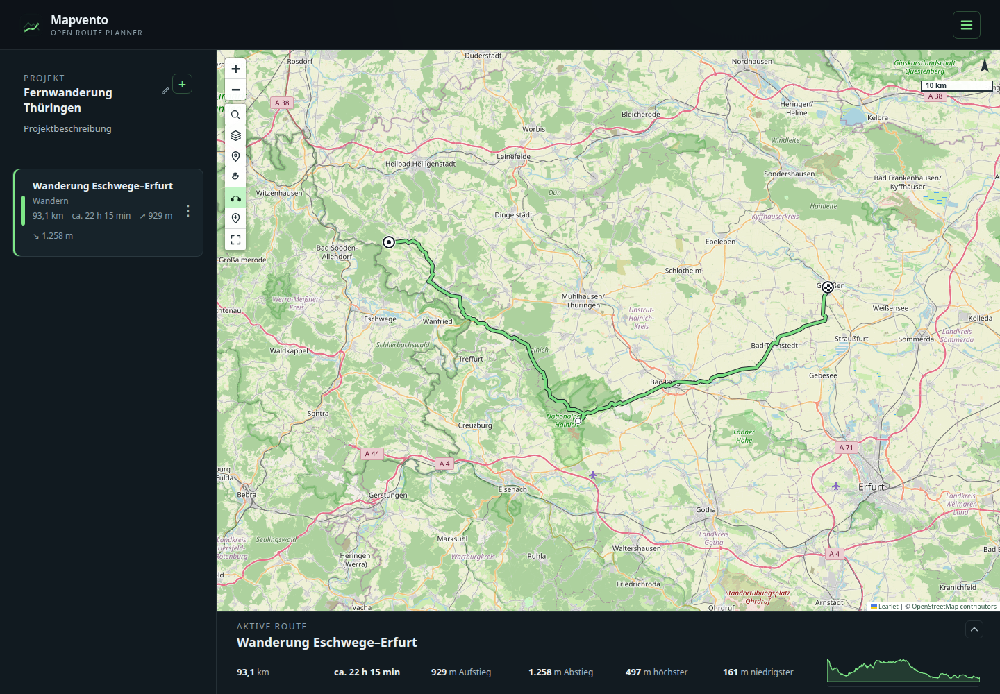
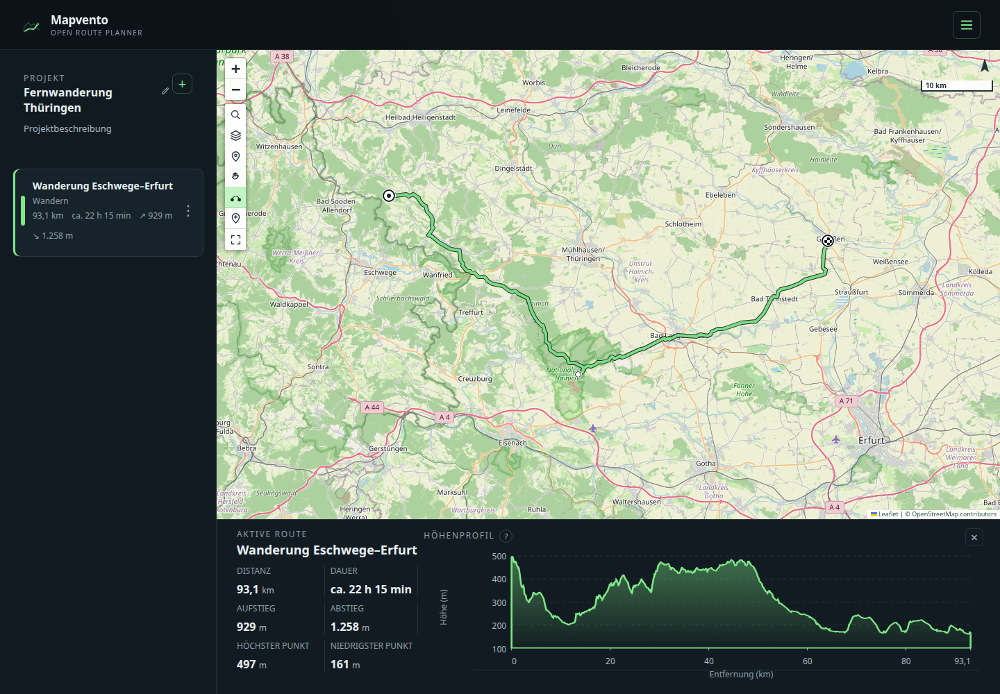
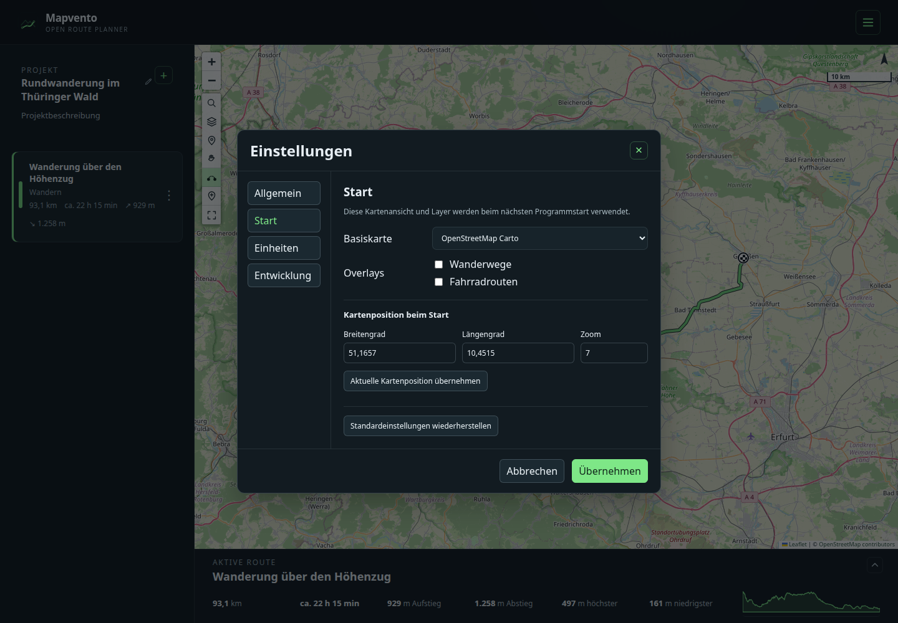
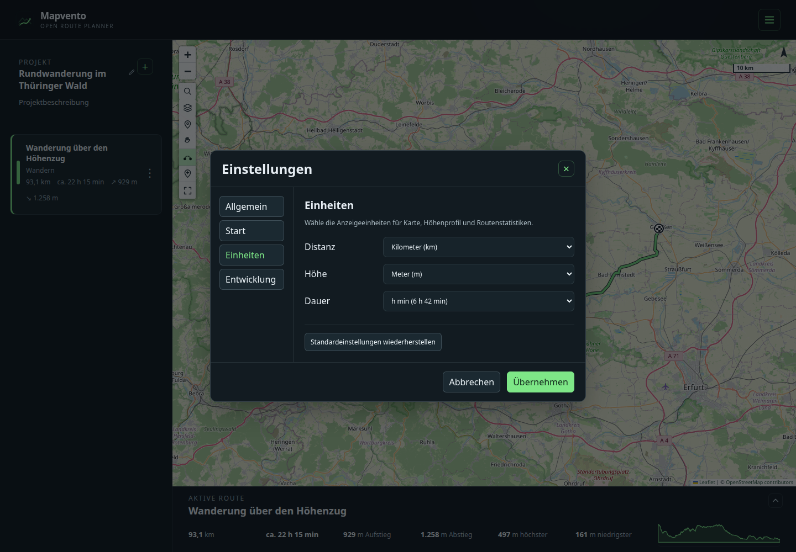
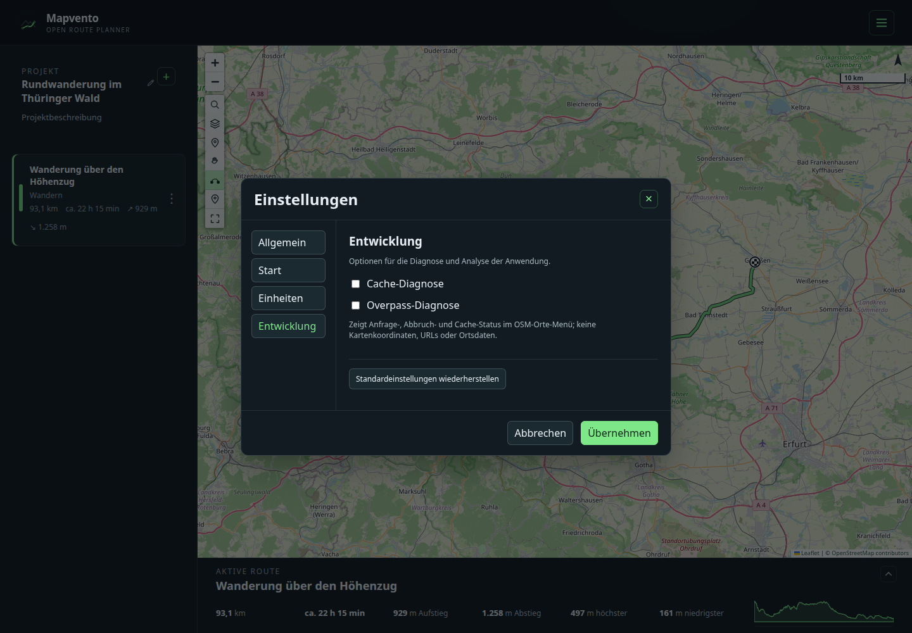
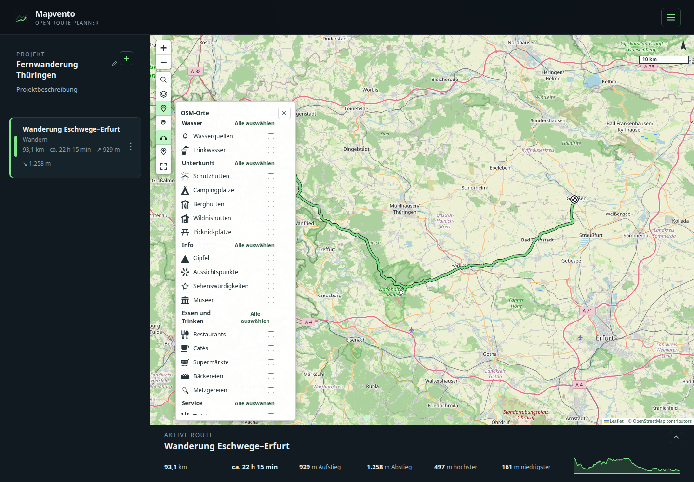

# Mapvento – Benutzerhandbuch

Mapvento ist ein Routenplaner für Wander- und Radtouren. Mit dieser Anleitung
lernst du die wichtigsten Arbeitsabläufe, Kartenwerkzeuge und Einstellungen
kennen. Die Screenshots zeigen eine Beispielroute; die angezeigten Werte und
Karteninhalte sind keine Tourenempfehlung. Die UI-Screenshots stammen aus der
Browseransicht unter Linux; native Dateidialoge können je Plattform anders
aussehen.

## Installation und Start

Lade Mapvento ausschließlich aus den
[GitHub-Releases](https://github.com/decaritat/Mapvento/releases/latest):

- **Windows 11:** Lade den `.exe`-Installer herunter und folge den Schritten
  des Installationsprogramms.
- **Ubuntu/Linux:** Lade die `.AppImage`-Datei herunter. Öffne ihre
  Dateieigenschaften, erlaube das Ausführen als Programm und starte sie
  anschließend. Die Linux-Releases zielen auf Ubuntu-24.04-Kompatibilität.

Mapvento startet mit einem neuen, noch ungespeicherten Projekt und einer
leeren Route. Öffne ein gespeichertes Projekt bei Bedarf über
**Hauptmenü → Projekt öffnen**. Die Update-Prüfung kann beim Programmstart auf
eine neuere Version und deren Download-Seite hinweisen; die Installation des
Updates erfolgt anschließend manuell.

## Arbeitsbereich

Links findest du Projektname, Beschreibung und Routenliste. Rechts liegt die
Karte mit ihren Werkzeugen. Unter der Karte zeigt das Höhenprofil die
Statistiken der aktiven Route.

## Erste Route planen

1. Wähle **+** neben dem Projektnamen und dann **Neue Route erstellen**.
2. Klicke mindestens zwei Punkte auf der Karte. Mapvento verbindet sie über
   den öffentlichen Dienst BRouter mit einer berechneten Wander- oder
   Fahrradroute. Weitere Klicks fügen Zwischenpunkte hinzu.
3. Bei erfolgreicher Berechnung wird die Route entlang des Wegenetzes
   angezeigt. Wenn BRouter nicht erreichbar ist oder keine Route findet,
   bleibt eine direkte Verbindung als sichtbarer Fallback bestehen. Über die
   Fehlermeldung kannst du die Berechnung erneut versuchen.
4. Bearbeite Projektname und -beschreibung über das Stiftsymbol neben dem
   Projektnamen. Die Beschreibung darf bis zu 180 Zeichen lang sein.
5. Speichere das Projekt im Hauptmenü mit **Projekt speichern** oder
   **Projekt speichern unter**. Projekte werden als `.mapvento.json`-Dateien
   gespeichert. Änderungen werden nicht automatisch in diese Datei
   geschrieben.

### Route bearbeiten

- **Punkt hinzufügen:** Bei aktiver **Routenbearbeitung** auf die Karte
  klicken.
- **Punkt verschieben:** Einen Routenpunkt ziehen.
- **Punkt auf der Linie einfügen:** Auf die bestehende Route klicken.
- **Punkt löschen:** Punkt auswählen und **Entf** drücken oder ihn mit der
  rechten Maustaste öffnen und **Routenpunkt löschen** wählen.
- **Abbrechen oder Auswahl aufheben:** **Esc** drücken.
- **Karte verschieben:** Das Werkzeug **Karte verschieben** aktivieren. In
  diesem Modus verändern Kartenklicks weder Route noch Punkte.
- **Route einpassen:** **Route fokussieren** wählen, um die aktive Route
  vollständig auf der Karte anzuzeigen.

Beim Ändern von Routenpunkten werden die betroffenen Segmente neu berechnet.
Für die Berechnung wird eine Internetverbindung benötigt.

### Routeneigenschaften

Öffne über **⋮** an einer Route die **Eigenschaften**. Für bearbeitbare Routen
kannst du Name, Beschreibung, Typ und Farbe einstellen. Als Routentyp stehen
**Wandern** und **Radfahren** zur Verfügung. Die Routenfarbe lässt sich über
Farbflächen oder eine eigene Farbe wählen.

**Abstandsmarker** zeigen Entfernungen entlang der Route an. Ihre Abstände
können sich automatisch an den Kartenmaßstab anpassen oder manuell festgelegt
werden. Der manuelle Abstand liegt zwischen 0,1 und 1.000 km (entsprechend in
Meilen, wenn diese Einheit eingestellt ist).

## Karte und Kartenwerkzeuge

Die senkrechte Werkzeugleiste am Kartenrand bietet:

| Werkzeug | Funktion |
| --- | --- |
| **Ort suchen** | Sucht Städte, Orte oder Sehenswürdigkeiten. Wähle ein Ergebnis, um die Karte dorthin zu bewegen. |
| **Kartenlayer** | Wählt die Basiskarte und optionale Kartenebenen aus. |
| **OSM-Orte und Filter** | Zeigt ausgewählte Orte aus OpenStreetMap an. |
| **Karte verschieben** | Verschiebt die Karte, ohne Route oder Punkte zu bearbeiten. |
| **Routenbearbeitung** | Fügt Routenpunkte hinzu und ermöglicht die Routenbearbeitung. |
| **Punkt / POI setzen** | Erstellt einen eigenen Punkt von Interesse auf der Karte. |
| **Route fokussieren** | Passt die aktive Route vollständig in den Kartenausschnitt ein. |

Die Basiskarten sind **OpenStreetMap Carto** und **OpenTopoMap**. Als
Kartenebenen können **Wanderwege** und **Fahrradrouten** eingeblendet werden.
Die jeweiligen Anbieter- und Lizenzhinweise bleiben am Kartenrand sichtbar.
Kartenlayer und Ebenen werden mit dem Projekt gespeichert; für den Start
kannst du sie zusätzlich in den Einstellungen festlegen.

### Orte und POIs

Die Ortssuche verwendet Nominatim. Im **OSM-Orte**-Panel kannst du nach
Ortstypen filtern und Kategorien gesammelt ein- oder ausschalten:

- **Wasser:** Wasserquellen, Trinkwasser
- **Unterkunft:** Schutzhütten, Campingplätze, Berghütten, Wildnishütten,
  Picknickplätze
- **Info:** Gipfel, Aussichtspunkte, Sehenswürdigkeiten, Museen
- **Essen und Trinken:** Restaurants, Cafés, Supermärkte, Bäckereien,
  Metzgereien
- **Service:** Toiletten, Duschen, Geldautomaten, Parkplätze
- **Transport:** Bahnhöfe, Bushaltestellen, Busbahnhöfe, Fähranleger

Lade neu ausgewählte Ortstypen über das angezeigte Ladesymbol. Mit
**Bereich um Kartenmitte aktualisieren** kannst du den aktuellen Ausschnitt
erneut abfragen. Die Verfügbarkeit hängt von den öffentlichen Overpass-Diensten
und der Internetverbindung ab.

Wähle einen angezeigten Ort, um seine verfügbaren Details und Links zu öffnen.
Du kannst daraus einen eigenen, bearbeitbaren POI vorbereiten. Eigene Punkte
lassen sich über **Punkt / POI setzen** erstellen; im Editor kannst du Titel,
Beschreibung und Symbol festlegen. Der Symbolwähler bietet Kategorien für
Wasser, Unterkunft, Info, Essen und Trinken, Service, Transport und Hilfe,
darunter zum Beispiel Quellen, Aussichtspunkte, Restaurants, Bahnhöfe,
Apotheken und Erste Hilfe. GPX-Wegpunkte sind schreibgeschützt.

## Route analysieren und GPX verwenden

Die kompakte Anzeige unter der Karte enthält Distanz, Dauer, Aufstieg, Abstieg
und die höchsten und niedrigsten Punkte. Öffne das Höhenprofil über die
Schaltfläche mit dem Pfeil, um den interaktiven Verlauf zu sehen. Klicke auf
das Profil oder bewege die Auswahl mit den Pfeiltasten; **Pos1** und **Ende**
springen an Anfang und Ende, **Esc** hebt die Auswahl auf. Die entsprechende
Position wird auch auf der Karte markiert.

Die Dauer ist bei aufgezeichneten GPX-Zeitstempeln daraus abgeleitet;
andernfalls ist sie eine Schätzung anhand von Streckenlänge und Höhenmetern.
Wenn keine vollständigen Höhenwerte vorliegen, verwendet das Profil
synthetische Ersatzwerte. Solche Werte sind keine verlässliche
Höhenmessung.

Über **+ → GPX-Datei importieren** kannst du eine GPX-Datei als Route
hinzufügen. Importierte GPX-Routen und deren Wegpunkte sind schreibgeschützt;
die Route kann nicht in Mapvento bearbeitet oder als GPX exportiert werden.
Eigene, bearbeitbare Routen lassen sich über **⋮ → GPX exportieren** als
`.gpx`-Datei ausgeben. Projekt- und Routenname sowie Beschreibung werden
beim Export übernommen.

## Projekte und Hauptmenü

Das Hauptmenü enthält:

- **Neues Projekt**, **Projekt öffnen**, **Projekt speichern** und
  **Projekt speichern unter**
- **Einstellungen**
- **Cache verwalten**
- **Info** mit Version, Datenquellen, Projektlinks und Drittkomponenten-Lizenzen
- In der Desktop-App zusätzlich **Beenden**

Beim Öffnen oder Erstellen eines Projekts und beim Beenden fragt Mapvento bei
ungespeicherten Änderungen, ob du speichern, verwerfen oder abbrechen möchtest.
Speichere wichtige Änderungen daher in der Projektdatei, bevor du Mapvento
schließt. Um später weiterzuarbeiten, öffne die `.mapvento.json`-Datei erneut.

## Einstellungen

Öffne **Hauptmenü → Einstellungen**. Mit **Übernehmen** werden Änderungen
gespeichert; **Abbrechen** verwirft nicht gespeicherte Änderungen.
**Standardeinstellungen wiederherstellen** setzt die Werte der jeweils
angezeigten Kategorie zurück.

### Allgemein

- **Beim Programmstart nach Updates suchen:** Prüft beim Start, ob eine neuere
  Version verfügbar ist. Die Einstellung ist in der Kategorie **Allgemein**
  ein- oder ausschaltbar.

### Start

Diese Kartenansicht und Layer werden beim nächsten Programmstart verwendet:

- **Basiskarte:** OpenStreetMap Carto oder OpenTopoMap
- **Overlays:** Wanderwege und/oder Fahrradrouten
- **Kartenposition beim Start:** Breitengrad, Längengrad und Zoomstufe
  (0 bis 19)
- **Aktuelle Kartenposition übernehmen:** Übernimmt Ausschnitt und Zoom der
  gerade geöffneten Karte

### Einheiten

- **Distanz:** Kilometer oder Meilen
- **Höhe:** Meter oder Fuß
- **Dauer:** Stunden und Minuten (`h min`), Uhrzeitdarstellung (`hh:mm`),
  Minuten (`min`) oder Stunden (`h`)

### Entwicklung

Diese Diagnoseoptionen sind für die Analyse von Problemen gedacht und
standardmäßig ausgeschaltet:

- **Cache-Diagnose:** Zeichnet Kachel-Ladevorgänge bis zum Schließen der
  Anwendung im Arbeitsspeicher auf. Im Cache-Dialog kannst du eine Messung
  starten, stoppen, speichern oder Messungen zum Vergleich laden.
- **Overpass-Diagnose:** Zeigt Anfrage-, Abbruch- und Cache-Status im
  OSM-Orte-Panel an. Eine Diagnose kann als JSON-Datei gespeichert werden.

Die Overpass-Diagnose enthält laut App keine Kartenkoordinaten, URLs oder
Ortsdaten. Cache-Diagnosen enthalten keine Kartenkoordinaten, URLs oder
Projektdaten. Prüfe Diagnose-Dateien vor dem Weitergeben trotzdem auf Inhalte,
die du nicht teilen möchtest.

## Cache verwalten

Öffne **Hauptmenü → Cache verwalten**, um belegten Speicher und gespeicherte
Kacheln nach Kartenanbieter und Layer zu prüfen. Du kannst einen Layer
aktualisieren, seine Kacheln löschen oder den gesamten Kachelcache leeren.
Löschvorgänge erfordern eine Bestätigung.

Der Cache ist auf 100 MiB begrenzt, wird projektübergreifend geteilt und
enthält nur bereits besuchte Kartenausschnitte. Er stellt keine vollständige
Offline-Karte bereit. Nach dem Löschen müssen Kacheln bei Bedarf erneut aus
dem Internet geladen werden. Der separate OSM-Orte-Cache lässt sich im
OSM-Orte-Panel löschen.

## Daten, Internet und Attribution

Projektdateien bleiben auf deinem Gerät. Mapvento lädt Kartenkacheln online
und verwendet öffentliche Dienste für Routing, Ortssuche und OSM-Orte. Für
die jeweilige Funktion werden die dafür nötigen Kartenausschnitte,
Routenkoordinaten, Suchbegriffe oder Filter an den entsprechenden Dienst
übermittelt. Mapvento benötigt daher eine Internetverbindung für aktuelle
Karten, Routing, Ortssuche und das Laden von OSM-Orten.

Die Kartenanbieter, Datenquellen und Lizenzhinweise sind in Mapvento am
Kartenrand sowie unter **Hauptmenü → Info** aufgeführt. Beachte die dort
verlinkten Nutzungsbedingungen. Bereits besuchte Kacheln können aus dem
lokalen Cache angezeigt werden; eine vollständige Offline-Navigation oder
Offline-Karte bietet Mapvento derzeit nicht.

## Wenn etwas nicht funktioniert

- **Karte wird nicht geladen:** Prüfe die Internetverbindung und die
  Kartenlayer-Auswahl. Bei einer Ladefehlermeldung kannst du den Layer erneut
  laden.
- **Route wird nur als direkte Verbindung angezeigt:** BRouter konnte keine
  Route berechnen. Prüfe die Punkte und Internetverbindung und wähle in der
  Fehlermeldung **Routing erneut versuchen**.
- **OSM-Orte fehlen:** Prüfe Ortstypen und Kartenausschnitt und lade den
  Bereich erneut. Öffentliche Overpass-Dienste können vorübergehend nicht
  verfügbar sein.
- **Dateiauswahl öffnet sich nicht:** Verwende die installierte Desktop-App
  oder öffne die Web-Version in einem Browser mit Dateizugriff. Je nach
  Browser kann Mapvento stattdessen einen Download starten.
- **Projekt nicht wiedergefunden:** Öffne die zuvor gespeicherte
  `.mapvento.json`-Datei über das Hauptmenü.

Fehler und Verbesserungsvorschläge kannst du im
[GitHub-Projekt](https://github.com/decaritat/Mapvento/issues) melden.
